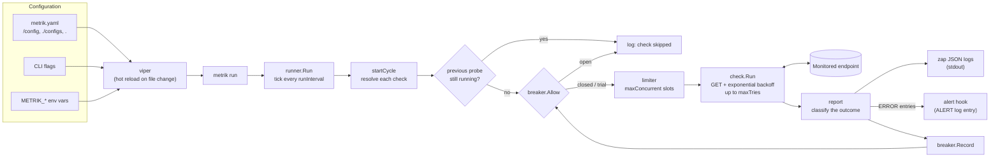
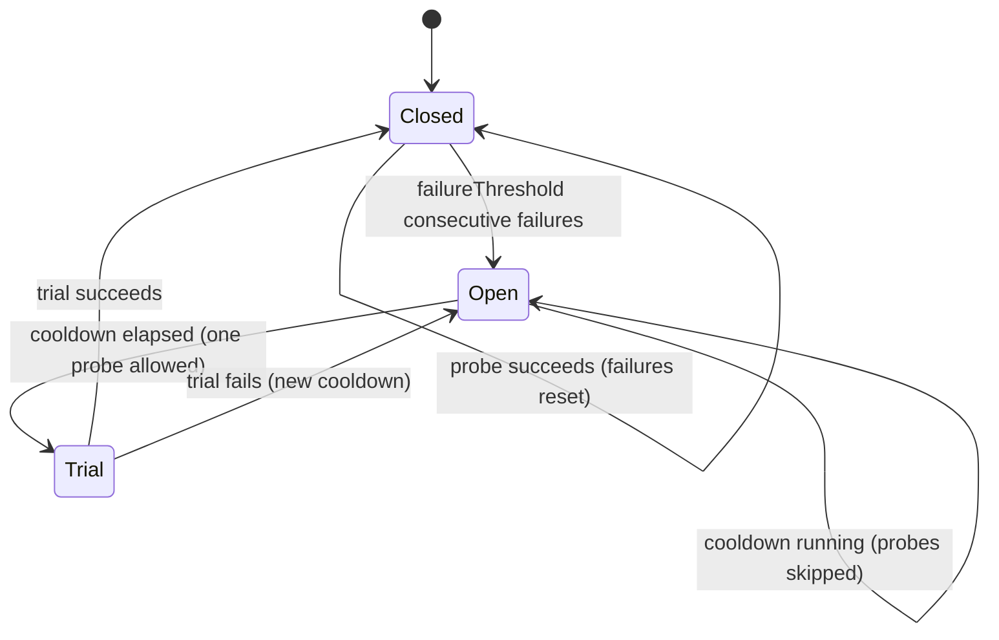
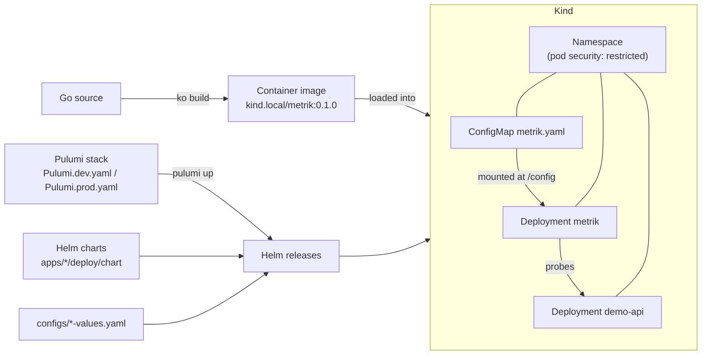

# Architecture

The repository is a small set of independent Go modules plus the tooling to deliver them. Metrik
is the health checker; the Demo API is a separate sample target that Metrik is pointed at, and it
knows nothing about Metrik.

| Path            | Role                                                                                 |
| :-------------- | :----------------------------------------------------------------------------------- |
| `apps/metrik`   | The health checker (CLI built with cobra, logging with zap)                          |
| `apps/demo-api` | The Demo API: a standalone HTTP service with live, slow and flaky readiness endpoints |
| `pulumi/`       | Pulumi (Go) program deploying both Helm charts to a cluster                          |
| `skaffold.yaml` | In-cluster development loop                                                          |

Inside `apps/metrik`, `cmd/metrik/` only wires commands, flags and configuration. The logic lives
in `internal/config` (settings, validation, per-check resolution), `internal/runner` (scheduling
and reporting), `internal/logger`, and the reusable `pkg/check` (probe with retries) and
`pkg/breaker` (circuit breaker).

## Runtime

Every cycle, each check is resolved against the global defaults, is skipped if its previous probe
is still running, passes through the circuit breaker, then runs in its own goroutine once it gets a slot from the concurrency limiter. The
outcome is logged at the right severity; error-level entries also go through the alert hook, and
the result feeds the breaker. Configuration reloads apply from the next cycle.

## Circuit breaker

`failureThreshold: 0` bypasses the breaker entirely. See
[Configuration](metrik-configuration.md#circuit-breaker) for the semantics.

## Delivery

Skaffold shortcuts this path during development: it builds with ko and deploys the same charts to
the `kind-dev` cluster on every change.
